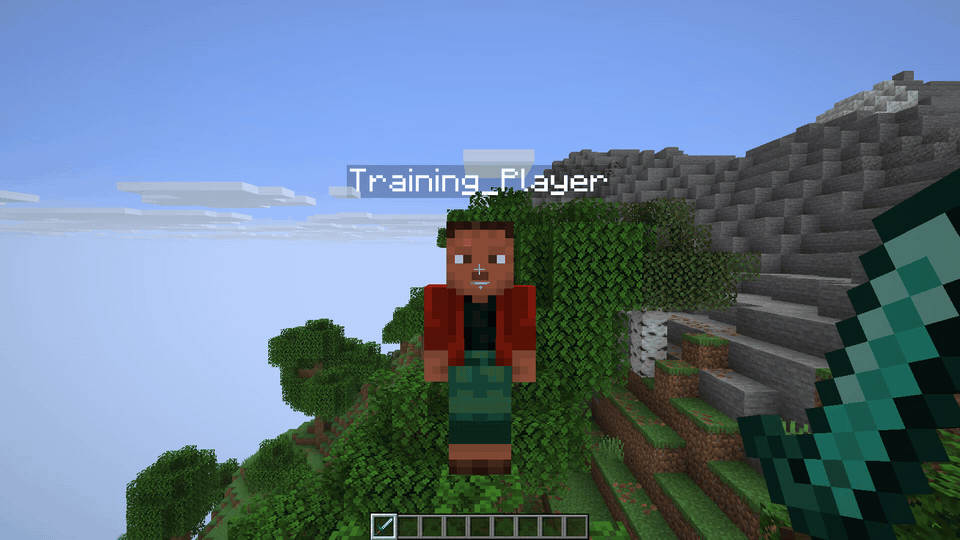
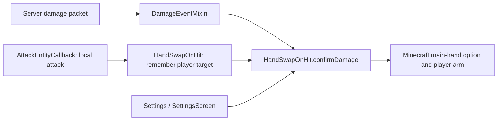

<div align="center">
<h1>HandSwapOnHit</h1>
<hr>
<p><strong>3 pieces in one place: confirmed player hits, main-hand switching, a configurable toggle.</strong></p>
<p>


</p>
<p>
<a href="https://github.com/hhhhhffd/HandSwapOnHit/releases/latest"></a>
<a href="https://github.com/hhhhhffd/HandSwapOnHit/releases"></a>
</p>
<p><a href="https://github.com/hhhhhffd/HandSwapOnHit/releases">Download</a> · <a href="#architecture">Architecture</a> · <a href="#build">Build</a></p>

</div>

## Executive Summary

HandSwapOnHit is a client-side Fabric mod for Minecraft Java 1.21.11. When the server confirms the local player's direct hit on another player, it flips Minecraft's main-hand setting. Two consecutive confirmed hits restore the original side; items and slots are not swapped, and the mod does not press attack.

Misses, hits on mobs, and other players' attacks do not trigger a switch. Servers that omit the normal damage confirmation identifying attacker and target may not trigger it.

## Technical Stack

| Layer | Technology | Version / role |
| --- | --- | --- |
| Core | Minecraft Java | 1.21.11 |
| Core | Fabric Loader | 0.20.1 in build; 0.18.4 or newer required |
| Core | Fabric API | 0.141.6+1.21.11 in build; 0.141.6 or newer required |
| Core | Java | 21 or newer |
| Integration | Mod Menu | 17.0.0 or newer, optional |
| Build | Fabric Loom / Gradle Wrapper | 1.13.6 / 9.2.1 |

## Architecture



- A local main-hand attack must match a server-confirmed direct melee damage event for the same player within three seconds; this avoids switching for unconfirmed attempts.
- `setHand` updates Minecraft's main-hand option and the local player's arm, then saves the option; inventory items remain untouched.
- `Settings` stores the enabled and notification toggles separately from Minecraft's own main-hand option.

## Project Structure

```text
.
├── src/client/        # Client initializer, settings, UI, mixin, translations
├── src/main/          # Fabric metadata and mixin declaration
├── gradle/wrapper/    # Gradle wrapper configuration
├── docs/media/        # Animated preview
├── build.gradle       # Loom build
└── gradle.properties  # Versions and build settings
```

## Installation and Settings

1. Install [Fabric Loader](https://fabricmc.net/use/installer/) 0.18.4 or newer for Minecraft Java 1.21.11 and use Java 21 or newer.
2. Place the mod JAR from [Releases](https://github.com/hhhhhffd/HandSwapOnHit/releases) and [Fabric API for 1.21.11](https://modrinth.com/mod/fabric-api/versions?g=1.21.11) in `mods`. No server installation is needed.
3. Optionally install [Mod Menu](https://modrinth.com/mod/modmenu) to access **Mods → HandSwapOnHit → Settings**.

Press **H** to toggle the mod; the key can be rebound in Minecraft's controls. The mod and toggle notifications are enabled by default. The optional settings screen provides the toggle, notifications, current-hand selection, and a shortcut to key bindings. Mod settings are stored in `config/handswaponhit.properties`; the hand uses Minecraft's own option.

## Build

Use JDK 21 and the included Gradle 9.2.1 wrapper.

```sh
./gradlew build
```

On Windows, run `gradlew.bat build`. The resulting JAR is in `build/libs/`.

## Deliverables & Links

[Releases](https://github.com/hhhhhffd/HandSwapOnHit/releases) · [Source](https://github.com/hhhhhffd/HandSwapOnHit) · [Animated preview](docs/media/preview.gif)

## License

Not specified; license terms are TBD.
